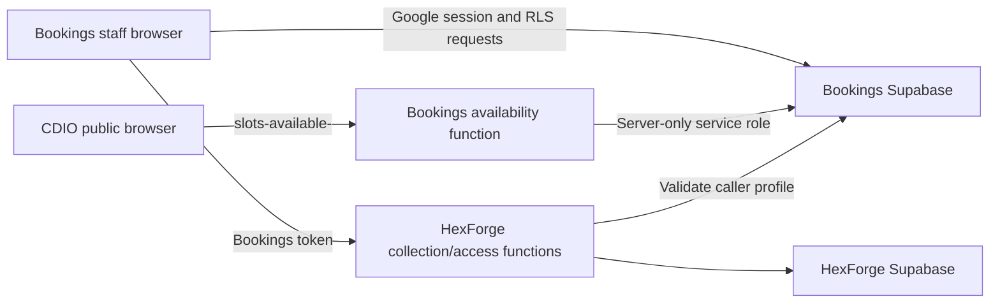

# Architecture

## Application map

React 18, TypeScript, Vite, and Material UI form a static single-page application. React Router defines pages in `src/app/App.tsx`; `Layout` checks sign-in and current profile access. Supabase provides Google authentication, PostgreSQL, row-level security (RLS), and booking Realtime events.

| Route | Purpose | Additional profile permission |
| --- | --- | --- |
| `/login`, `/about`, `/privacy`, `/terms` | Public sign-in and information | None |
| `/bookings` | Daily grid; create, reserve, start, end, edit, extend, delete, search, Bulk Mode | None |
| `/collections` | HexForge help desk board and collection workflow | None |
| `/maintenance` | Toggle room issue labels | None |
| `/bug` | Report feedback, filter existing issues, upvote | None |
| `/document` | In-app help | None |
| `/access` | Booking permissions/expiry and HexForge allow-list | `authorisation` |
| `/report` | Monthly Excel export | `analytics` |
| `/settings` | Hours, testing clock, rooms, courses | `settings` |

Ordinary staff can perform operational booking, maintenance, bug, and collection actions. The access page's older “viewer access” wording does not describe a read-only role. Route checks improve navigation; database/function authorization remains the enforcement boundary.

## Data and states

`profiles` records allowed Google identities and administrative flags. `rooms` stores capacities, availability, borrowable items, and issue labels. `courses` stores names and display colors. `bookings` stores a date, local start/end times, room, course, staff name, student numbers, borrowed items, group ID, and state. `settings` stores keyed JSON configuration. `bugs` stores feedback/status/votes. `logs` stores optional activity measurements.

The authoritative database upgrade path is `services/bookings/supabase/migrations`. Files in `services/bookings/supabase/schemas` are reference definitions, not a substitute for the complete migration history. Booking exclusion constraints prevent overlapping intervals for the same room/date; setting a record to `Ended` does not itself remove its recorded time interval.

Bookings belong to one room (`room_id`, deletion cascades to bookings) and optionally one course (`course_id`, deletion sets it to null). `course_name` holds an Other course label. `booked_by` is text, not a profile foreign key. A group's shared `bulk_booking_id` is text, not a separate group table. Student counts for grouped bookings use the `student_numbers` text format `bulk booking - <group UUID> - <count>`; preserve this format when changing creation or reporting.

| Settings key | JSON value | Consumers |
| --- | --- | --- |
| `operation_hours` | `{start, end}` in `HH:mm` | Staff grid/form and public function |
| `saturday_hours` | `{enabled, start, end}` | Public function; edited in staff Settings |
| `testing_clock` | `{enabled, date, time}` | Staff clock; CDIO reads shared configuration separately |

Database booking dates and times have no timezone. The grid combines them into local browser timestamps before calculating states. Check South African local dates and half-hour boundaries when changing time handling; access expiry is a separate database `timestamptz` and uses server time.

Stored states are `Reserved`, `Active`, and `Ended`. The UI derives `Late` when a reservation is more than 10 minutes past its start and `Overdue` when an active booking is past its end. The dot indicates status; the card fill comes from the course color. Ending a single booking early rounds the current time to the nearest half hour and shortens its interval; ending at/before its start removes the record. Group quick-end changes states without shortening each interval. Extension creates an ended original segment and a new active segment. These writes are sequential; inspect both segments if a later write fails.

Bulk Mode creates one group per date/time combination across the selected rooms. Group start/end/delete and selected edits require a scope choice. Room changes apply to one record; course/count edits use the group path. Review `BookingPanel.tsx` before changing group behavior: its group update path does not mirror all individual time-edit fields.

`BookingGrid` listens for booking Realtime events. Other loaded configuration and collection data may require page refresh. `shared/lib/time.ts` reads the shared testing clock, otherwise uses browser time; status updates occur roughly once a minute. Booking grid and form currently use `operation_hours`; the settings page also saves `saturday_hours`, which these booking components do not consume.

## Authentication and integrations

Google sign-in requests `openid email profile` through Supabase Auth. Login checks the email allow-list, updates the Google name/avatar, and links a pending profile to the Auth user. The layout rechecks on navigation, focus, every minute, and known expiry deadlines. The access-expiry migration adds immediate database checks for protected requests, including already-issued tokens.

Bookings connects to a separate HexForge Supabase project through `api/printingCollections.ts` and `api/printingAccess.ts`. Calls carry the Bookings session token and the HexForge public API key. The HexForge Edge functions `bookings-collection` and `bookings-profile-access` validate the booking identity/permissions and act on printing data. Their source belongs to `services/printing/supabase/functions/` at the repository root; server secrets remain private backend configuration.

The collection UI can search, save receipts, collect parts, release completed projects to the desk, and prepare email previews. Email previews expose copy controls; the app does not send the message. Printing sign-in allow-list access is separate from booking access/expiry.

Current RLS allows unexpired staff to read/write bookings and update rooms, including operational issue labels. The `settings` flag controls room insertion/deletion and course/settings writes. The `analytics` flag protects report navigation, not a separate database read permission. Only `authorisation` staff manage profile access. Feedback state/admin updates are maintained through the backend; the frontend reports issues and invokes the guarded `increment_bug_upvotes` RPC. When adding a table or security-definer RPC, explicitly apply access expiry enforcement as well as its feature permissions.

## Public availability backend

The availability backend source is `services/bookings/supabase/functions/slots-available-/index.ts` at the repository root. The test function remains separate. Moving frontend code does not deploy either function.

The public CDIO frontend invokes the trailing-hyphen slug `slots-available-`. The hosted gateway has `verify_jwt=false`; the function returns aggregated availability, not student records. Its server configuration reads `SUPABASE_URL` and `SUPABASE_SERVICE_ROLE_KEY` from the Edge Function environment. Never copy the service-role value into the frontend or documentation.

The function selects enabled rooms with minimum capacities 2, 4 or 6, assigning open/closed/boardroom types. It reads operation and Saturday hours and builds half-hour slots. Each room enters one longest-duration bucket, capped at two hours; availability of only 30 minutes is intentionally excluded. Ended intervals use a look-ahead from the next half-hour slot, so public counts are guidance to confirm at the desk. On Saturdays the response's operation hours are replaced by the Saturday hours. Sunday closure is enforced by the public frontend.

For maintenance, compare this source with the target backend before deploying; review the gateway setting separately from code. Scheduled services belong in private operational records.

## Source entry points

- `src/features/bookings/components`: grid, booking dialog, search, toolbar, and status calculation.
- `src/features/bookings/components/BookingsScreen.tsx`: quick action confirmations and group scope.
- `src/features/collections/components/CollectionsScreen.tsx`: collection workspace and confirmation flow.
- `src/api`: database, auth, activity and printing adapters.
- `src/shared/lib`: common date/time and access expiry helpers.
- `src/features/*/hooks` and `model`: feature state, interactions and calculations.
- `services/bookings/supabase/migrations`: database changes and security rules.
- `tests`: PGlite database/logic tests and Playwright browser regressions.

For availability request/response examples and compatibility requirements, see [development](development.md#availability-function-contract).
